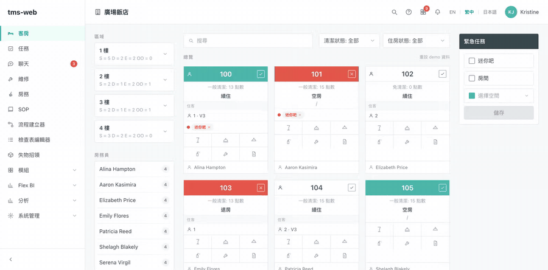

# TMS Web — 飯店房務任務管理系統（前端 Prototype）

飯店房務與維運的後台觀摩 demo：即時房況看板、房間分配、週排程、任務管理、
自動化流程、分析報表、BI 儀表板、員工聊天，外加一支手機 App 模擬畫面。
純前端專案——所有資料為 mock（zustand + localStorage 持久化），不需要後端即可執行。

## Demo



## 技術棧

- **Vite** + **React 18** + **TypeScript**（strict）
- **React Router v6** 路由
- **Zustand**（persist middleware）管理各頁面狀態，存 localStorage
- **i18next / react-i18next** 多語系：繁體中文（預設）、English、日本語
- **Tailwind CSS** 樣式；圖示與圖表全為手刻 inline SVG，無額外 UI / 圖表套件

## 啟動

```bash
npm install
npm run dev        # 開發伺服器
npm run typecheck  # tsc -b --noEmit
npm run build      # 型別檢查 + production build
npm run preview    # 預覽 production build
```

## 頁面總覽

| 頁面 | 路徑 | 功能 |
|---|---|---|
| 客房總覽 | `/` | 房卡看板（28 間房 × 4 樓層）：房況點擊循環切換、改派房務員、搜尋與篩選、樓層統計連動、緊急任務指派、六格快速動作（迷你吧／服務請求／客房餐飲／清潔缺失／報修／備註） |
| 任務 | `/tasks` | 任務管理：新增（含範本）、tab 篩選、搜尋排序、詳情面板操作；快速動作與手機報修會自動進入此處 |
| 聊天 | `/chat` | 員工聊天：1:1 私訊＋群組頻道、未讀 badge、**訊息自動翻譯**（譯文為主、原文可切換顯示）；與手機端同步 |
| 維修 | `/maintenance` | 報修單管理：統計卡、篩選、技師指派、狀態循環切換；合併快速動作來源 |
| 房間分配 | `/allocation` | 值班房務員選擇、**依點數平衡的自動指派**、房間 chip 選取與移轉、確認排程 |
| 週排程 | `/schedule` | 三週切換、房務員／客房雙視圖、任務 chip 詳情、點數明細即時統計、每日點數超額警示 |
| SOP | `/sops` | SOP 文件庫：分類清單＋步驟式內容檢視、新增／刪除 |
| 流程建立器 | `/workflow` | 自動化規則：清單＋「當／如果／則」節點編輯器（條件與動作可增刪、連線動態重算） |
| 檢查表編輯器 | `/checklists` | 檢查表範本：分區與項目增刪改、複製範本、即時儲存（與手機「房間檢查」同構） |
| 失物招領 | `/lost-found` | 失物登記、狀態流轉（保管中→已歸還／已處理，含領回人記錄）、篩選 |
| 分析 | `/analytics/*` | 清潔缺失／報修／清潔時間三報表：**facet 交叉過濾**、CSV 匯出、快速動作資料合併 |
| BI 儀表板 | `/bi` | 手刻 SVG 圖表：hover tooltip、圖例點擊排除、自動化視圖、篩選、PNG 匯出 |
| 模組 | `/modules` | 系統模組啟用開關總覽 |
| 手機 App | `/mobile` | 手機外框模擬：登入、帳號切換、客房、房間詳情、報修、**房間檢查清單（含草稿）**、賓客關係、聊天——與桌面端共用資料即時同步 |
| 舊版介面 | `/legacy` | 專案最初的 starter 版面，保留備查 |

頂欄另有：**通知中心**（未讀管理）、**最近活動**（快速動作即時動態）、語言切換。

## 資料與狀態

- 各頁面有獨立的 zustand store（`src/pages/workday/*/store.ts`），以 `persist`
  存 localStorage（key 皆為 `tms-workday-*`），並以 `version` + `migrate` 控管結構變更。
- 跨頁連動：客房快速動作與手機報修 → 任務 store → 維修頁／分析頁／最近活動同步呈現。
- 多數頁面提供「重設 demo 資料」還原種子狀態。

## 多語系

- 翻譯以「頁面 fragment」組織：`src/pages/workday/i18n/<頁面>.ts`，每檔含
  `en / zhTW / ja` 三語，以 `satisfies` 約束三語 key 同形。
- fragment 統一掛載進 `src/i18n/locales/{en,zh-TW,ja}.ts` 的 `workday` 子樹；
  手機文案在各 locale 檔的 `mobile` 區塊。
- 預設繁體中文，選擇存 localStorage（key `tms-lang`）。

## 專案結構

```
src/
  pages/workday/        新版（預設）介面
    WorkdayShell.tsx    側欄 + 頂欄 layout（通知/活動下拉、語言切換）
    <Page>.tsx          各頁面
    <page>/             該頁的 store 與子元件
    i18n/               每頁一個三語 fragment
    mobile/             手機 App 模擬畫面
  i18n/                 i18next 設定與 locale 檔
  pages/ + components/  舊版 starter（/legacy）
  domain/ mock/ hooks/  舊版的型別、mock repository 與 React Query hooks
```

## 備註

- 本專案為內部觀摩用 prototype：以市售房務系統的公開 demo 作為功能行為參考，
  介面為原創實作、品牌一律使用 tms-web。
- 之後要接真後端時，各 store 的 actions 即為替換縫：把 mutation 換成 API 呼叫、
  種子資料換成查詢結果即可，頁面元件不需變動。
